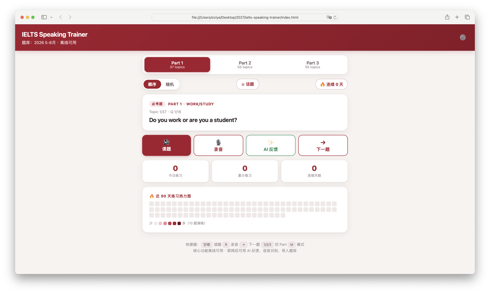

# IELTS Speaking Trainer

> 一个离线可用的雅思口语练习器 —— **我用十天，把自己的雅思口语从 5.5 练到了 6.5**。

  

打开网页就能练：官方题库 → 考官语音读题 → 自己开口说 → 录音回放。联网后还能让 AI 给你的回答打分、挑毛病、给改写建议，并支持导入换季题库。

**核心功能离线可用；联网只是锦上添花。**

## 为什么做这个

备考时我发现市面上的口语 App 要么收费、要么必须联网、要么没法回放自己的录音复盘。于是我给自己写了一个，只解决一件事：**随时随地、对着真实题库、开口练、能回放。**

用了十天，口语从 5.5 提到 6.5（总分 7.0）。这不是一个练习用的 demo，而是我真实使用、并靠它拿到结果的东西。

## 功能

- **完整题库**：内置 2026 年 5–8 月题库（Part 1 37 个话题、Part 2/3 各 55 个话题 + cue card + Part 3 追问），按「必考题 / 新题 / 保留旧题」分类
- **语音读题**：浏览器 TTS 优先选 Google / Microsoft 在线自然语音，语速、音色可调，**切题后自动读题**
- **录音回放**：麦克风录音（自动选浏览器支持的格式），录完即回放
- **Part 2 模拟考场**：cue card 卡片视图 + 1 分钟准备 + 2 分钟答题计时
- **顺序 / 随机**两种练习模式 + 话题搜索跳转
- **键盘快捷键**：空格读题 · R 录音 · → 下一题 · 1/2/3 切 Part · M 切换模式
- **练习统计**：今日练习、累计练习、连续天数、近 90 天热力图（正反馈，帮助你坚持）
- **两级反馈**：没填 API Key 也有**离线基础反馈**（篇幅/词汇/重复词/连接词/句长/句子开头/填充词）；填了 Key 再升级成 AI 智能评分与改写（**评语为中文，改写示例为英文**）
- **可安装成手机 App（PWA）**：部署到 https 后，手机浏览器「添加到主屏幕」
- **完全离线**：不联网也能刷题、读题、录音、看统计

## 联网增强（可选）

| 功能 | 需要什么 | 说明 |
|---|---|---|
| 语音识别（听写你说了什么） | 浏览器自带，免费 | Chrome / Edge 效果最好，需联网；iOS Safari / Firefox 可能不支持 |
| AI 打分 + 改进建议 + 改写 | DeepSeek API Key | 设置页填 `sk-...`，AI 会给出总分、流利度/词汇/语法分、亮点、改进建议、改写示例 |
| 离线基础反馈 | 无（永远可用） | 没填 Key 也能用：基于文字统计，给出篇幅、词汇多样性、连接词、句长四项反馈（不给 band 分） |
| 导入换季题库 | 无 | 设置页上传 JSON，格式见 `bank-template.json` |

## 快速开始

**本地使用**：直接双击 `index.html`（无需安装任何东西，纯离线）。

**部署到网址（推荐，解锁 PWA + 系统通知 + 跨域稳定）**：

1. 电脑浏览器打开 [app.netlify.com/drop](https://app.netlify.com/drop)（免费注册/登录）
2. 把整个 `ielts-speaking-trainer` 文件夹**拖进网页**，几秒后得到网址
3. 手机上打开网址 → 菜单「添加到主屏幕 / 安装应用」→ 全屏运行、可离线

## 配置 DeepSeek AI

1. 打开 App → 右上角 ⚙️ 设置
2. 填 DeepSeek API Key（在 [platform.deepseek.com](https://platform.deepseek.com) 创建）
3. 回答完一道题，点「AI 反馈」，先说一遍（或用语音识别），AI 会给分和建议

> ⚠️ **隐私**：API Key 只存在你自己的浏览器 localStorage，不经过任何服务器。不启用 AI 时，所有数据（录音、练习记录、题库）都不离开本机。

## 技术亮点

- **零依赖单文件应用**：纯 HTML/CSS/JS，无 CDN、无构建工具，`file://` 直开可用
- **离线优先（Offline-first）**：PWA（`manifest.json` + `sw.js`），部署到 https 后可安装成手机 App、离线缓存
- **Web 语音双引擎**：`speechSynthesis` 读题（TTS）+ `SpeechRecognition` 听写（ASR）
- **本地数据持久化**：题库、录音、练习记录、热力图全部存 `localStorage`（`ielts:*` 前缀），支持 JSON 导出备份
- **AI 接口集成**：走 DeepSeek 的 OpenAI 兼容接口（`https://api.deepseek.com/chat/completions`），前端直接调用
- **隐私优先**：API Key 仅存本地、不经过任何服务器；不联网时所有数据都不离开本机

## 已知边界

- 语音识别需联网，且仅在支持 Web Speech API 的浏览器可用（Chrome/Edge）
- AI 打分基于文字转写，**无法评估发音**，分值为参考、非官方
- iOS 上浏览器对 `SpeechRecognition` 支持有限，可用「录音 + 手动贴文字」代替
- 本地 `file://` 打开时 Service Worker 不注册（离线缓存需 https 部署）

## License

MIT
